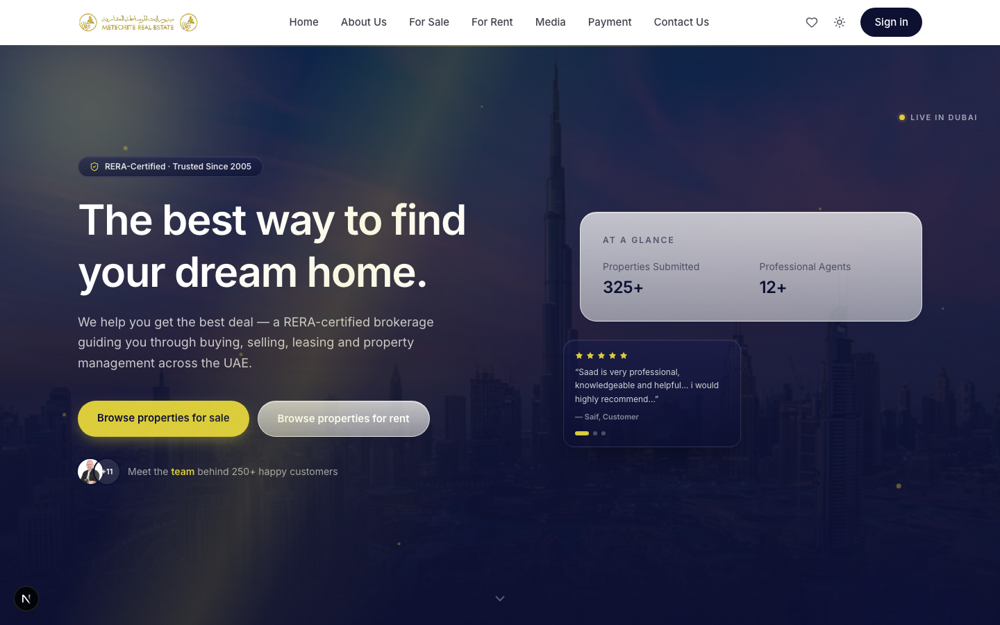
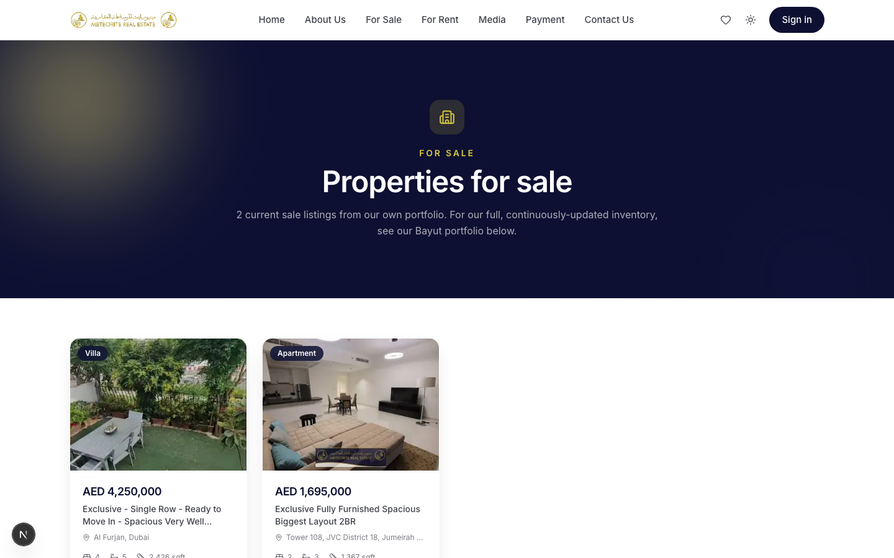
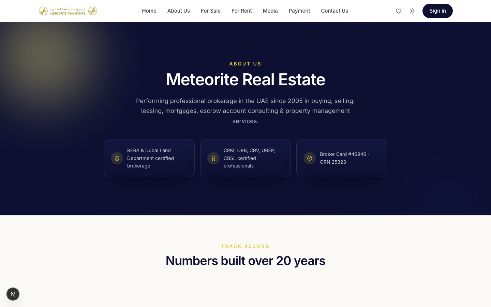
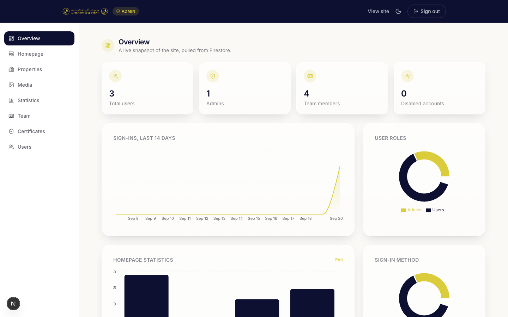
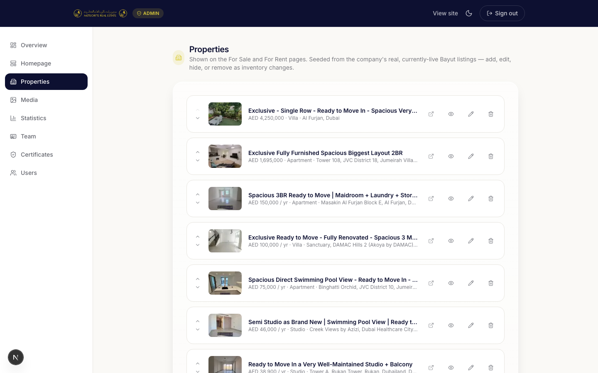
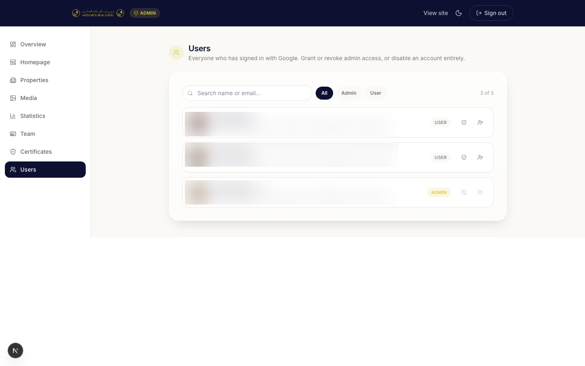
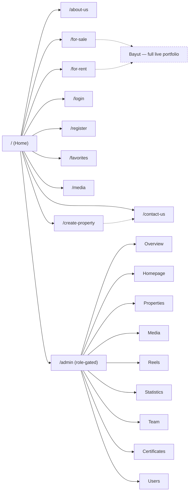

<div align="center">


### A real Dubai brokerage's website — redesigned, backed by Firebase, and deployed on Cloudflare Workers

RERA-certified · Trusted since 2005 · Next.js 16 · TypeScript · Tailwind CSS v4 · Firebase · Cloudflare Workers

[](https://nextjs.org)
[](https://www.typescriptlang.org)
[](https://tailwindcss.com)
[](https://firebase.google.com)
[](https://workers.cloudflare.com)
[](#quality-checks)
[](#quality-checks)

</div>

---

## Contents

- [About](#about)
- [Screenshots](#screenshots)
- [Features](#features)
- [Admin dashboard](#admin-dashboard)
- [Site map](#site-map)
- [Tech stack](#tech-stack)
- [Getting started](#getting-started)
- [Deployment (Cloudflare Workers)](#deployment-cloudflare-workers)
- [Environment variables](#environment-variables)
- [Project structure](#project-structure)
- [Listings, messages and notifications](#listings-messages-and-notifications)
- [Media, images and video](#media-images-and-video)
- [Verified content policy](#verified-content-policy)
- [Known gaps &amp; roadmap](#known-gaps--roadmap)
- [Quality checks](#quality-checks)

## About

Meteorite Real Estate is a RERA-certified Dubai property brokerage operating since 2005. This repository started as a ground-up rebuild of its public website — the previous repo held only a placeholder `README.md` — and has since grown into a full platform: a real Firebase backend, a role-based admin dashboard the company actually uses to manage its own content, and a production deployment on Cloudflare Workers.

The design follows Apple's **Liquid Glass** language — translucent, frosted surfaces, soft depth and light, purposeful motion — in the company's own navy and gold, never a generic AI purple/blue gradient. Every fact rendered on the site (contact details, credentials, statistics, testimonials, the agent roster, and the property listings) either traces back to the live site and the company's real Bayut portfolio, or is entered by the company itself through the admin dashboard — nothing is fabricated.


## Screenshots

All screenshots below are from the live application. Personal account details in the Users panel are blurred for privacy — everything else is real content.

| Homepage | For Sale |
|---|---|
|  |  |

| About Us | Admin Overview |
|---|---|
|  |  |

| Admin — Properties | Admin — Users (blurred) |
|---|---|
|  |  |

## Features

| | |
|---|---|
| 🏠 **Homepage** | A hero that slides through night photographs of Dubai (floating header over it), live stats, company intro, "Faces & Places" collage, Featured Developments (video projects), property discovery, featured project, a reel wall (TikTok / Instagram / YouTube / Facebook), a self-moving poster band, Leadership with the CEO's message, team, testimonials, contact CTA |
| 🥃 **Liquid Glass UI** | Frosted `.glass` panels, animated navy/gold glow fields, shimmering hover borders — no generic AI-purple gradients |
| 🎞️ **Motion** | Framer Motion scroll reveals, staggered card entrances, a shared logo-loading animation for both route transitions and auth actions — all reduced-motion aware |
| 🏢 **Real property listings** | For Sale / For Rent pages show real property cards (price, beds/baths/size, location, photo) seeded from the company's own live Bayut portfolio, fully admin-manageable |
| 📸 **Media** | Podcasts, pinned and latest posts, a fanned poster deck with a full-screen viewer, video-tour links and social shortcuts — all managed from the admin dashboard |
| 🎬 **Reels & video** | Reels from four platforms in a 3-D coverflow (the middle one plays); project films with bundled or Google-Drive video, played through a range-capable proxy |
| 🔐 **Real authentication** | Google sign-in and email/password sign-up/sign-in, backed by Firebase Auth |
| 🛡️ **Role-based admin dashboard** | No admin password anywhere — admin access is a `role` on your normal account, promoted from within the dashboard itself. See [Admin dashboard](#admin-dashboard). |
| ⭐ **Favorites** | Guest-friendly, `localStorage`-backed saved properties |
| ♿ **Accessibility** | Visible focus states, alt text, reduced-motion support, semantic landmarks |
| 📱 **Responsive** | Tested from 390px mobile up through desktop, no horizontal overflow |
| ☁️ **Cloudflare Workers deployment** | Runs as a real Cloudflare Worker via OpenNext — see [Deployment](#deployment-cloudflare-workers) |

## Admin dashboard

Every admin-only feature is reached from the same `/login` every visitor uses — there is no separate admin URL or password to remember. Whether a signed-in account is an admin is a `role` field on its Firestore user document; the very first admin is bootstrapped once via an `INITIAL_ADMIN_EMAIL` environment variable, and every admin after that is promoted from the **Users** panel by an existing admin.

| Section | What it manages |
|---|---|
| **Overview** | Visits (all time, today, per day, per section), users, admins, team members; sign-in charts; homepage statistics; quick links to add content. The sidebar is grouped: Content, Company, Access |
| **Homepage** | Hero pictures (the slideshow behind the headline), hero text, the CEO's message, Featured Developments (video projects with facts, images and offer sheets), the featured project, Google reviews summary and client testimonials |
| **Properties** | Add/edit/delete/reorder/hide listings shown on For Sale and For Rent, each with a main photo and up to 10 more (they form the gallery on its own page) |
| **Media** | The poster series (upload, reorder, delete) plus social post links, native photo posts and podcast embeds, with pinning |
| **Reels** | Paste a TikTok / Instagram / YouTube / Facebook link to add a reel; title, cover, hide, reorder; your TikTok and YouTube account links (shown in the reel wall and the footer) |
| **Statistics** | The homepage stat numbers, each with its own visibility toggle |
| **Team** | The agent/leadership roster — photos, titles, contact details, Leadership bios, reorderable and independently hideable |
| **Certificates** | Licensing/registration certificates (several images each) shown on About Us |
| **Messages** | The enquiries sent from the Contact page and from property pages: unread marker, reply by email / WhatsApp / call, delete. New messages can notify the team (see Notifications) |
| **Users** | Search/filter every signed-in account, promote or revoke admin access, disable accounts |

`/admin` is protected twice — once by the edge middleware (`src/proxy.ts`) and again by a server-side check in the admin layout — so it never depends on either check alone.

## Site map



## Tech stack

| Layer | Choice |
|---|---|
| Framework | [Next.js 16](https://nextjs.org) (App Router) |
| Language | TypeScript |
| Styling | Tailwind CSS v4 (CSS-first `@theme` tokens) + a small Liquid Glass utility layer in `globals.css` |
| Animation | [Framer Motion](https://www.framer.com/motion/) (`Reveal.tsx` scroll-in wrapper, hero entrance, `useReducedMotion`-aware) |
| Charts | [Recharts](https://recharts.org) in the admin Overview |
| UI runtime | React 19 |
| Fonts | `next/font` — Inter |
| Backend | Firebase — Firestore (all content) + Firebase Auth (Google + email/password) |
| Data access | A hand-rolled [Firestore REST client](src/lib/firestore-rest.ts) (Web Crypto JWT signing, no `firebase-admin`) — see [Deployment](#deployment-cloudflare-workers) for why |
| Auth/sessions | [`next-firebase-auth-edge`](https://github.com/awinogrodzki/next-firebase-auth-edge) — edge-native session cookies, no Node-only Admin SDK calls |
| State | React Context (`AuthProvider`, `FavoritesProvider`) + `localStorage` |
| Hosting | Cloudflare Workers via [`@opennextjs/cloudflare`](https://opennext.js.org/cloudflare) |
| Linting | ESLint (`eslint-config-next`) |

### Liquid Glass design system

Three CSS primitives in [`globals.css`](src/app/globals.css), composed rather than hard-coded per component:

| Class | Effect |
|---|---|
| `.glass` / `.glass-dark` | Frosted, translucent panel (`backdrop-filter: blur + saturate`) in the brand's own light or navy tone |
| `.glow-field` | Two soft, slowly drifting navy/gold blur blooms behind a section — the color that the glass refracts |
| `.shimmer-border` | A thin animated gold sheen that sweeps a card's border on hover |

All three respect `prefers-reduced-motion` and fall back to a static frosted card with no animation.

## Getting started

```bash
npm install
npm run dev
```

Then open **[http://localhost:3000](http://localhost:3000)**. You'll need a `.env.local` — see [Environment variables](#environment-variables).

```bash
npm run build   # production build (plain Next.js)
npm run lint    # ESLint
npm run start   # serve the production build locally
```

## Deployment (Cloudflare Workers)

This app runs as a real Cloudflare Worker, not a traditional Node server. That constraint shaped a real architectural decision worth understanding before touching the backend:

**`firebase-admin` cannot run in Cloudflare Workers.** It talks to Firestore over native gRPC/raw TCP sockets, and the Workers runtime is a V8 isolate sandbox with no socket access — not even with the `nodejs_compat` flag. So instead of the Admin SDK:

- **Firestore** is accessed through [`src/lib/firestore-rest.ts`](src/lib/firestore-rest.ts) — a small REST client that signs a JWT with the service account key via the Web Crypto API, exchanges it for a Google OAuth2 access token, and calls the Firestore REST API directly over `fetch`. It supports get/list/create/update/delete plus atomic multi-write commits (used for race-safe one-time seeding and for the reorder-swap feature in the admin panels).
- **Auth/sessions** run on [`next-firebase-auth-edge`](https://github.com/awinogrodzki/next-firebase-auth-edge), which reimplements the pieces of the Admin Auth SDK this app needs (`verifyIdToken`, `setCustomUserClaims`, `getUser`, `updateUser`) on Web Crypto, plus its own edge-native session-cookie middleware (`src/proxy.ts`).

Everything else — Firestore's data model, security rules, and every admin feature — is unchanged; this only replaced *how* the server talks to Firebase, not *what* it stores.

### Build & deploy

```bash
npm install
npx wrangler login              # one-time Cloudflare authentication
npm run deploy                  # opennextjs-cloudflare build && deploy
```

Or step by step:

```bash
npx opennextjs-cloudflare build   # produces .open-next/worker.js
npx wrangler deploy --dry-run     # validate config without deploying
npx wrangler deploy               # deploy for real
```

`wrangler.jsonc` defines the Worker (`meteorite-real-estate`), its static-assets binding, the `nodejs_compat` / `global_fetch_strictly_public` compatibility flags, and a Workers KV namespace (bound twice, as `NEXT_INC_CACHE_KV` and `NEXT_TAG_CACHE_KV`).

#### Page cache & the Free plan's CPU limit

A Worker on the Cloudflare **Free** plan gets roughly **10 ms of CPU per request**, and a React render of even a simple page costs 10–100+ ms. With OpenNext's default (dummy) cache every "static" page was re-rendered — with ~20 Firestore calls on the homepage — on every request, and the Worker intermittently returned `503` (Cloudflare error 1102, "Worker exceeded resource limits"). `open-next.config.ts` therefore:

- stores the prerendered pages in **Workers KV** and serves hits from the middleware layer (*cache interception*), so a visit costs ~2–8 ms and never loads the Next server bundle;
- uses a KV **tag cache**, so the admin panel's `revalidatePath()` still works: the edited page is re-rendered once on its next visit and re-cached. KV is eventually consistent, so an edit can take up to ~60 s to appear;
- caches **pages only**, not Next's `fetch` data cache, so a re-render always reads fresh Firestore data.

`npm run deploy` is `opennextjs-cloudflare build && node scripts/strip-segment-data.mjs && opennextjs-cloudflare deploy`. The script drops the build-time `fetch` cache and the unused per-segment prefetch payloads (all `<Link>`s use `prefetch={false}`) from the cache before it is uploaded to KV. Each deploy writes ~17 KV entries (the free KV allowance is 1,000 writes/day). Entries from old builds are never read again; delete them from the namespace occasionally.

Other Free-plan notes: the page-view beacon (`POST /api/track-visit`) is answered in `src/proxy.ts` rather than the route handler, and the Firebase auth middleware only runs for `/admin`, `/api/login` and `/api/logout`. Admin pages and admin APIs still need the full server bundle (100+ ms of CPU), so an admin request can occasionally fail on a cold Worker — retrying works. Don't enable a Cloudflare "Cache Everything" rule on the HTML: the Worker already caches, and an edge copy would hide admin edits.

**One manual step per Firebase project:** any domain you deploy to (including a Cloudflare `*.workers.dev` subdomain) must be added under Firebase Console → Authentication → Settings → Authorized domains, or Google/email sign-in will fail with `auth/unauthorized-domain`. `localhost` and `*.firebaseapp.com`/`*.web.app` are authorized by default; nothing else is.

## Environment variables

Copy `.env.example` to `.env.local` for local development. For a Cloudflare deployment, everything below except the `NEXT_PUBLIC_*` keys should be set as a `wrangler secret` (never as a plain `vars` entry in `wrangler.jsonc`, and never committed):

| Variable | Where it's used | Secret? |
|---|---|---|
| `FIREBASE_ADMIN_PROJECT_ID` | Firestore REST client, edge auth config | Treat as secret |
| `FIREBASE_ADMIN_CLIENT_EMAIL` | Firestore REST client, edge auth config | Treat as secret |
| `FIREBASE_ADMIN_PRIVATE_KEY` | JWT signing for both the Firestore REST client and auth | **Secret** |
| `INITIAL_ADMIN_EMAIL` | Bootstraps the first admin on first sign-in | Treat as secret |
| `AUTH_COOKIE_SIGNATURE_KEY_CURRENT` / `_PREVIOUS` | Signs the edge session cookie (unrelated to Firebase) | **Secret** |
| `NEXT_PUBLIC_FIREBASE_API_KEY` | Client-side Firebase config | Public (compiled into the browser bundle) |
| `NEXT_PUBLIC_FIREBASE_AUTH_DOMAIN` | Client-side Firebase config | Public |
| `NEXT_PUBLIC_FIREBASE_PROJECT_ID` | Client-side Firebase config | Public |
| `NEXT_PUBLIC_FIREBASE_STORAGE_BUCKET` | Client-side Firebase config | Public |
| `NEXT_PUBLIC_FIREBASE_MESSAGING_SENDER_ID` | Client-side Firebase config | Public |
| `NEXT_PUBLIC_FIREBASE_APP_ID` | Client-side Firebase config | Public |

Set a secret with `npx wrangler secret put VARIABLE_NAME` (it prompts for the value, or reads it from stdin — never pass secret values as a bare CLI argument, since those can end up in shell history).

## Project structure

```
src/
├─ app/
│  ├─ (site)/            public marketing routes — about-us, for-sale, for-rent, media, ...
│  ├─ admin/              role-gated dashboard (Overview, Homepage, Properties, Media, ...)
│  └─ api/
│     ├─ admin/           CRUD routes behind requireAdmin()
│     └─ auth/provision/  upserts the Firestore user profile after sign-in
├─ components/            section & UI components (Header, Hero, PropertyCard, Admin*Panel, ...)
├─ lib/
│  ├─ content.ts          single source of truth for hardcoded verified facts
│  ├─ firestore-rest.ts   Workers-compatible Firestore REST client
│  ├─ *-data.ts           one data module per collection (properties, agents, media-posts, ...)
│  ├─ session.ts          thin wrapper over next-firebase-auth-edge's getTokens()
│  └─ auth-context.tsx    real Firebase Auth state (Google + email/password)
├─ proxy.ts               edge middleware — session refresh, /admin gating, image and video routes, fast 404s
public/brand/             logo, hero photo, CEO portrait — pulled from the live site
docs/screenshots/         the images used in this README
```

## Listings, messages and notifications

- **Property pages** (`/property/<id>`): a gallery, price and specs, description, amenities, an enquiry form and similar listings. Listing cards link to them. They are ordinary cached server pages; the only client code is the gallery and the form. `src/proxy.ts` lists `property` among the known paths, so keep it there.
- **Search, filters and compare** on For Sale / For Rent run in the browser on the listings already on the page (no extra requests). Up to three listings can be compared side by side.
- **Saved properties:** the heart on a card is stored on the device and, once signed in, on the account (`favorites/<uid>` in Firestore, merged on sign-in). The Saved page shows the listings as cards.
- **Contact messages** are stored in the `messages` collection (public `POST /api/contact`: hidden-field trap, link limit, per-address rate limit). They appear in Admin → Messages.
- **Notifications:** set any of these as Worker secrets and the matching channel turns on by itself; with none set nothing is sent.
  - Telegram: `TELEGRAM_BOT_TOKEN` and `TELEGRAM_CHAT_ID`
  - Email through Resend: `RESEND_API_KEY` and `NOTIFY_EMAIL` (optional `NOTIFY_FROM`; without a verified domain Resend only delivers to the account owner's address)
  - `npx wrangler secret put TELEGRAM_BOT_TOKEN`, etc.
- **Analytics** (admin overview) also keep device split, hour of day (Dubai time), top pages and top listings on the running-totals document. Crawlers and monitors are not counted.
- **Smooth mode:** weak devices (or a footer switch) turn off blur, glows and looping decoration (`html[data-lite="true"]`, see `LiteMode.tsx` and the end of `globals.css`).

## Media, images and video

Notes on the parts that are easy to break:

- **Uploaded images are served by URL, never inlined.** Photos uploaded in the admin are stored as data URLs on Firestore documents, but public pages reference them as `/api/img/<kind>/<id>?v=<hash>` (answered by `src/proxy.ts`). Admin-side getters keep the raw data so edit forms round-trip. Extra pictures (reel covers, poster series, hero pictures, project-film images) go through `/api/admin/film-images` and are stored in `filmImages`.
- **Video.** Bundled mp4 files are served through `/api/film/file/<name>` (an edge-cached copy with byte-range support, so looping and seeking work); Google Drive videos are streamed through `/api/film/drive/<id>`, and only for ids saved in a project film. Keep each bundled file under 25 MB (the static-asset limit).
- **Reels.** TikTok (`player/v1`), YouTube and Facebook play inside the page; **Instagram does not allow embedded playback**, so its cards show the reel's own cover (fetched from the public embed page and stored here) and open the reel on Instagram. The CSP `frame-src` list in `next.config.ts` has to include any platform you embed.
- **Hero.** The slideshow pictures are `public/brand/hero/*.jpg` (Unsplash, credited in `CREDITS.txt`) or uploads from Admin → Homepage → Hero pictures. A saved list that only contains the retired first set of pictures is treated as "never customised" (see `src/lib/hero-images.ts`).
- **Seeded content.** One-time seeds (the two TikTok reels, the two team posters in Media) use a marker document in `_meta`, so deleting them in the admin sticks.
- **Caching.** `public/_headers` makes `/_next/static/*` immutable. `StyleGuard` re-requests the stylesheets (and reloads once) if a page ever arrives without its styles; the route error boundary retries once by itself before showing "Something went wrong".

## Verified content policy

Every hardcoded company fact — phone numbers, email, RERA ORN, broker card, address — lives in [`src/lib/content.ts`](src/lib/content.ts), sourced directly from **meteoriterealestate.com**. Editable content (stats, team, certificates, testimonials, properties, media posts) lives in Firestore and is managed through the admin dashboard by the company itself — no prices, reviews, credentials, or property listings are fabricated anywhere in this codebase. The property listings seeded into Firestore were fetched directly from the company's own real, currently-live Bayut portfolio.

> If you update a fact in `content.ts`, cite where it came from in the commit message.

## Known gaps & roadmap

| Area | Status | What's needed |
|---|---|---|
| Property detail pages | 🟡 Cards only | For Sale/For Rent show rich cards with a WhatsApp CTA; no dedicated `/property/[id]` page yet |
| Favorites sync | 🟡 Device-local only | Needs real property IDs synced to the signed-in user's account |
| Uploaded images | 🟡 Stored in Firestore | Resized client-side and stored as base64 on documents (served by URL) — no Firebase Storage (needs the paid Blaze plan, not enabled by choice) |
| Instagram reels | 🟡 Open on Instagram | Instagram does not allow its reels to play inside another site |
| Hero video | 🟡 Waiting for a clean cut | The company's cinematic film has titles burned into it; a version without them would replace the photo slideshow |
| Add Property | 🟡 Linked out | Original page content on WordPress couldn't be verified or migrated — it links to a contact form instead (`/payment` and `/blog` redirect to the home page) |
| Account disable latency | 🟡 Not instant | Disabling a user takes effect within its current session's token lifetime (~1 hour), not immediately — a tradeoff of the edge-native auth session (see [Deployment](#deployment-cloudflare-workers)) |

## Quality checks

- ✅ `npm run build` — all routes compile and prerender
- ✅ `npm run lint` — zero errors
- ✅ `node --test tests/unit.test.mjs` — unit tests for the pure helpers (reel links, project films, poster and hero lists, image URLs, reviews)
- ✅ End-to-end verified against the live Firebase project and the live Cloudflare deployment: sign-in, admin access, and CRUD writes on every admin panel

---

<div align="center">
<sub>Built for Meteorite Real Estate · Dubai, UAE</sub>
</div>
